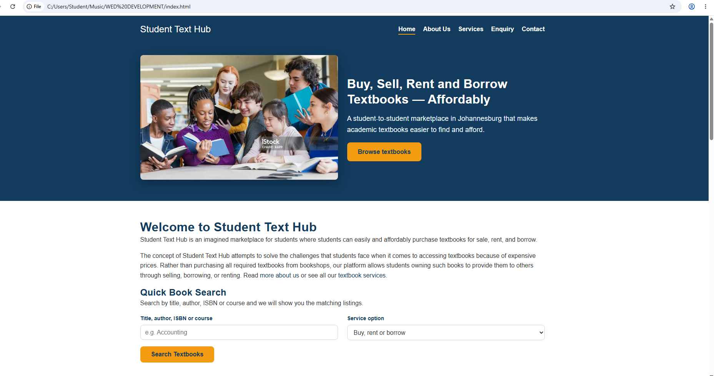
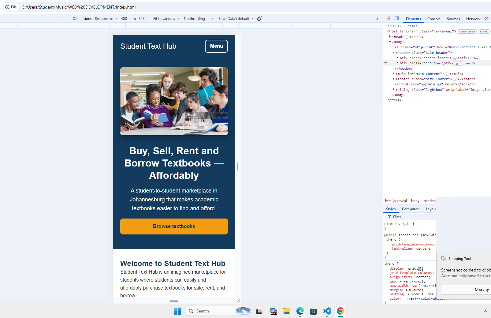

# Student Text Hub — Website Repository

**Module:** WEDE5020 — Web Development
**Student:** Nqobile Sibongile Ngcobo (ST10529659)

## Project Overview

Student Text Hub is a hypothetical student‑to‑student marketplace that lets
students buy, sell, rent and borrow academic textbooks. The site was
proposed in Part 1 and is being built out across Part 1 (content and
structure) and Part 2 (visual design and responsiveness) and Part 3 (JavaScript, SEO,
forms and deployment) of this module's assignment.

## File Structure

```
WED DEVELOPMENT/
├── home.html        # single HTML page containing all four sections (Home, About, Services, Contact)
├── css/
│   └── styles.css    # external stylesheet — all visual and responsive styling
├── image.png          # hero/header image
└── README.md          # this document
```

Keeping the stylesheet in its own `css` folder, separate from the markup,
follows standard front‑end practice of separating structure (HTML) from
presentation (CSS), which keeps the project easier to update and scale as
more pages or assets are added (Sklar, 2016).

## Part 2 — Design Summary

### Typography
Headings and body text use a `Poppins`/Arial stack with a defined type
scale (`--fs-sm` to `--fs-xxl`) set with `rem` units, so the whole page
scales predictably if a user changes their base font size — a technique
recommended for accessible, harmonious typography (MDN, 2024a).

### Colour Palette
The palette from the Part 1 proposal was carried through using CSS custom
properties (`:root` variables) so that colour is controlled from a single
location:

| Colour | Hex | Use |
|---|---|---|
| Dark blue | `#123B5D` | headers, navigation, branding |
| Light blue | `#EAF4FB` | backgrounds, info sections |
| White | `#FFFFFF` | page background |
| Orange | `#F39C12` | buttons and calls to action |
| Dark grey | `#333333` | body text |

Colour and contrast choices were checked against the Web Content
Accessibility Guidelines' minimum contrast requirements so that text
remains readable for users with different vision abilities (W3C, 2023).

### Layout
- **Flexbox** is used for the header/navigation bar, so the logo and menu
  align in a single row on desktop and wrap cleanly on smaller screens
  (MDN, 2024b).
- **CSS Grid** is used for the hero section, the About cards, the four
  Services cards and the search form, giving a clear multi‑column desktop
  layout that can collapse to fewer columns at each breakpoint (MDN,
  2024c).
- Interactive states (`:hover`, `:focus`, `:active`) are applied to
  navigation links, buttons and form fields so the interface gives clear
  visual feedback, which supports both usability and keyboard
  accessibility (Nielsen Norman Group, 2024).

### Responsive Design
Two breakpoints were implemented using `em`‑based media queries, which
keeps breakpoints tied to the user's font size rather than a fixed pixel
value (MDN, 2024d):

| Breakpoint | Range | Behaviour |
|---|---|---|
| Desktop | > 768px | Multi-column grid layout (4‑column services, 2‑column about/search) |
| Tablet | ≤ 768px (48em) | Header stacks, services/about drop to 2 columns, search form drops to 1 column |
| Mobile | ≤ 480px (30em) | Fully single‑column layout, full‑width buttons, stacked navigation |

Relative units (`rem`, `em`, `%`) are used throughout for spacing, type
and widths instead of fixed pixel values, which is the approach
recommended for building flexible, device‑agnostic layouts (Marcotte,
2010). The header image also carries `srcset`/`sizes` attributes so the
browser can choose an appropriately sized image for the viewport, in line
with responsive image guidance (MDN, 2024e); a next iteration of this
project would add two or three actual image resolutions to make full use
of this attribute.

Layout and spacing were checked and adjusted using browser developer
tools' device toolbar, which is the standard way to test a responsive
layout without needing physical devices for every screen size (Nielsen
Norman Group, 2024).

### Screenshot Evidence



Open `home.html` in a browser, open Developer Tools (F12) → the device
toolbar, and capture the page at three widths, then paste the images into
this section:


## Part 3 - Functionality, SEO and Forms

### JavaScript enhancements (vanilla JS - no libraries, so nothing external can break)
| Feature | Where | How |
|---|---|---|
| Accordion (FAQ) | index, contact | `<button aria-expanded>` toggles a `hidden` panel; icon and fade animation |
| Tabs | services | `role="tablist"`, click and Left/Right arrow-key support |
| Modal | services | Native `<dialog>` opened with `showModal()`; shows book details; closes with Esc, button or backdrop click |
| Gallery + lightbox | index | Click a cover to open a larger view; previous/next buttons and arrow keys |
| Animations | site-wide | CSS transitions/keyframes; `IntersectionObserver` adds a scroll-reveal class; disabled for `prefers-reduced-motion` |
| Advanced DOM manipulation | services, forms | Cards, modal content and form feedback are built with `createElement`/`textContent` (also prevents XSS) |
| Map | contact | **Embedded Google Maps `<iframe>` - no Leaflet or other map library** (avoids library/API-key errors). A campus `<select>` updates the iframe `src` with JavaScript |

### Dynamic content
`services.html` loads `data/books.json` with `fetch()` and renders the listings. Users can **search** (title, author, ISBN, course), **filter** (buy/rent/borrow, available only) and **sort** (title, price). The home page Quick Book Search passes `?q=` to this page. If `fetch` is blocked (e.g. opening the file straight from disk), `listings.js` falls back to an identical built-in data set.

### Forms
- **enquiry.html** - name, email, optional phone, book title/ISBN, service option, date needed and message. After validation, JavaScript uses AJAX (`fetch`) to look the book up in `books.json` and shows a response on **cost and availability** without reloading the page.
- **contact.html** - name, email, optional phone, university, message type and message. After validation the details are compiled into an email (To, Subject, Body) shown in a preview, and the user presses a button to send it via a `mailto:` link to the recipient stated in the code (`studenttexthub@gmail.com` - **replace with the real address**).
- **Validation** - HTML5 attributes (`required`, `minlength`, `maxlength`, `type="email"`) plus JavaScript for: email format, South African phone numbers (`082 123 4567` / `+27 82 123 4567`), future-only dates, minimum/maximum message lengths. Errors appear under each field (`role="alert"`, `aria-invalid`) on blur and on submit; focus moves to the first invalid field. Forms use `novalidate` so the custom messages are shown consistently.

### On-page SEO
- **Keywords** - researched around what students search for ("buy textbooks", "rent textbooks", "second-hand university textbooks Johannesburg", "borrow textbooks") and placed in titles, headings, first paragraphs, alt text and the `keywords` meta tag.
- **Titles and meta descriptions** - unique for every page (under ~60 and ~160 characters respectively).
- **Headings** - exactly one `<h1>` per page, followed by logical `<h2>`/`<h3>` levels.
- **Images** - descriptive file names (`students-sharing-textbooks-800.webp`, `accounting-textbook.svg`), meaningful `alt` text, `width`/`height` to avoid layout shift.
- **URLs** - short, lowercase and descriptive (`/about.html`, `/services.html`, `/enquiry.html`); the home page is `index.html` so the domain root works.
- **Internal linking** - the nav, footer and in-text links join all pages (e.g. About -> Services, Contact -> Enquiry).
- **Mobile-friendliness** - viewport meta tag, responsive grid, collapsible mobile menu.
- **Structured data** - JSON-LD `LocalBusiness` markup on the home page; Open Graph and Twitter Card tags on every page; canonical links.

### Off-page SEO (strategy)
- **Backlinks** - plan: ask campus societies/SRCs, student blogs and university "student life" pages to link to the site; list the site in student-resource directories; guest-post on budgeting-for-students articles.
- **Social media** - footer links to Facebook, Instagram, X and LinkedIn; Open Graph tags ensure shared links show a title, description and image. Planned content: "book of the week", semester-start reminders, campus meet-up photos.
- **Local SEO** - Johannesburg/Gauteng named in titles, copy, structured data and the campus map; plan to create a Google Business Profile and use campus-specific pages.

### Additional requests
- **robots.txt** - allows crawling, blocks `/data/`, points to the sitemap.
- **sitemap.xml** - lists all five pages with priorities and last-modified date.
- **Page speed** - hero image reduced from 1.3 MB (PNG) to ~23-69 KB (WebP, three sizes through `srcset`/`sizes`, JPG fallback); book covers are tiny SVGs; below-the-fold images use `loading="lazy"`; hero is preloaded; scripts use `defer`; no external fonts, frameworks or libraries; long-term cache headers for images.
- **Security** - Content-Security-Policy meta tag (`script-src 'self'`, `object-src 'none'`, restricted frames/forms); no inline scripts or styles; user input is only ever inserted with `textContent` (no `innerHTML`); `rel="noopener noreferrer"` on external links; query-string values are length-limited; `_headers` file adds `X-Content-Type-Options`, `X-Frame-Options`, `Referrer-Policy`, `Permissions-Policy` and HSTS; the host (Netlify/GitHub Pages) serves the site over HTTPS.

### Deployment
Deployed on Netlify (drag the project folder onto https://app.netlify.com/drop or connect the GitHub repository; no build command, publish directory is the project root). Live URL: **add your live link here** (then update the `BASE` URLs in `sitemap.xml`, `robots.txt` and the canonical/Open Graph tags if the address differs from `https://student-text-hub.netlify.app`).

## Changelog

### [Part 3] - JavaScript, SEO, Forms and Deployment
**Feedback from Part 2 - corrections made**
- **Fixed** the site being a single `home.html` that duplicated the About, Services and Contact content, while separate pages also existed. Home now contains only home content (`index.html`); the other content lives on its own page, and the README structure above was updated to match.
- **Renamed** `home.html` to `index.html` so the site works at the domain root when deployed; all navigation links were updated.
- **Fixed** broken image references: the hero `srcset` pointed to `image.png` (a path that did not exist next to the pages) and `image.png` was duplicated in the root and `images/`. The hero now uses a `<picture>` element with optimised files in `images/`, descriptive names, `width`/`height` and alt text.
- **Fixed** multiple `<h1>` elements: the site name was an `<h1>` on every page. It is now a paragraph/link and each page has exactly one `<h1>`.
- **Fixed** the `btn btn-primary` class on submit buttons (no `.btn-primary` style existed) and changed button text from white to dark blue because white on orange (#F39C12) failed the WCAG 2.2 contrast minimum.
- **Fixed** the footer being missing on `services.html`/`contact.html`, and added a skip-to-content link and `aria-current="page"` to the active nav link.
- **Added** a mobile "Menu" button because the stacked navigation took up too much of small screens.

**Functionality**
- **Added** `js/main.js`: accordion (FAQ), tabs (services), lightbox gallery (home), scroll-reveal and hover animations, mobile menu and campus map selector.
- **Added** `js/listings.js` and `data/books.json`: dynamically loaded textbook listings with search, filter, sort and a details modal on `services.html`.
- **Added** an embedded Google Maps `<iframe>` on `contact.html` instead of Leaflet/other map libraries, to avoid library loading and API-key errors.
- **Added** `js/forms.js`: client-side validation with inline error messages for both forms, South African phone and future-date checks, character counters, AJAX (`fetch`) enquiry response with cost/availability, and compilation of the contact form into a `mailto:` email.
- **Changed** the home page Quick Book Search to submit to `services.html?q=...` so it returns real results (previously it did nothing).
- **Rebuilt** `enquiry.html` and `contact.html` forms with the required fields, validation attributes and different purposes (enquiry = price/availability response, contact = general email).

**SEO and additional requests**
- **Added** unique `<title>`, meta description, keywords, canonical, Open Graph and Twitter Card tags on every page, plus JSON-LD `LocalBusiness` data on the home page.
- **Added** `robots.txt`, `sitemap.xml`, a custom `404.html` and footer social links and internal links.
- **Optimised** the hero image (1.3 MB PNG -> 23-69 KB WebP/JPG), added lazy loading, preload and `defer` scripts.
- **Added** security measures: Content-Security-Policy, safe DOM insertion (no `innerHTML`), `rel="noopener noreferrer"`, and a `_headers` file with security headers.
- **Updated** this README (file structure, Part 3 documentation, references).
- **Deployed** the site (see Deployment section for the live link).

### [Part 2] — CSS Styling and Responsive Design
- **Added** external stylesheet `css/styles.css` and linked it from
  `home.html` (replacing the previous unstyled markup).
- **Added** CSS custom properties (`:root` variables) for the colour
  palette and typography scale proposed in Part 1.
- **Added** a type scale using `font-family`, `font-size`, `font-weight`,
  `line-height` and `letter-spacing` for consistent, harmonious
  typography across headings and body text.
- **Added** Flexbox layout for the header/navigation and CSS Grid layout
  for the hero, About cards, Services cards and search form, to create a
  clear desktop layout using a minimum number of selectors.
- **Added** visual styling (`background-color`, `border`, `border-radius`,
  `box-shadow`) to cards and buttons, plus `:hover`, `:focus` and
  `:active` pseudo‑classes on links, buttons and form fields.
- **Added** responsive design: two `em`‑based media query breakpoints
  (tablet ≤ 768px, mobile ≤ 480px), relative units (`rem`/`em`/`%`)
  throughout, and `srcset`/`sizes` on the hero image.
- **Fixed** invalid `<image>` tag in the header, replaced with a
  semantically correct `` element with descriptive `alt` text.
- **Added** a proper `<nav>` landmark with `aria-label="Primary"` around
  the navigation menu, and wrapped the four page sections in a `<main>`
  landmark, improving the document's semantic structure and
  screen‑reader navigation.
- **Fixed** form accessibility: every `<label>` is now explicitly
  associated with its input via matching `for`/`id` attributes, so
  assistive technology announces the correct label for each field
  (W3C, 2023).
- **Added** `lang="en"` and a `viewport` meta tag to `<head>`, which is
  required for the responsive breakpoints to work correctly on mobile
  browsers (MDN, 2024d).

### [Part 1 feedback] — Corrections carried into the Part 2 build
- Reviewed the mark/feedback for Part 1 and applied the general markup
  and accessibility corrections above (semantic `<nav>`/`<main>`,
  corrected `` tag, label/input associations) as part of preparing
  the page for CSS styling.


## References
1.Meyer, E.A. (2008) CSS Tools: Reset CSS. Available at: https://meyerweb.com/eric/tools/css/reset/ (Accessed: 18 September 2026).

2. Marcotte, E. (2010) *Responsive Web Design*. A List Apart, 25 May.
   Available at: https://alistapart.com/article/responsive-web-design/
   (Accessed: 13 September 2026).

3. MDN Web Docs (2026c) *Responsive web design*. Mozilla. Available at:
   https://developer.mozilla.org/en-US/docs/Learn_web_development/Core/CSS_layout/Responsive_Design
   (Accessed: 13 September 2026).

4. MDN Web Docs (2026e) *CSS styling basics*. Mozilla. Available at:
   https://developer.mozilla.org/en-US/docs/Learn_web_development/Core/Styling_basics
   (Accessed: 13 September 2026).

5. MDN Web Docs (2026f) *CSS grid layout*. Mozilla. Available at:
   https://developer.mozilla.org/en-US/docs/Web/CSS/CSS_grid_layout
   (Accessed: 13 September 2026).

6. MDN Web Docs (2026g) *Basic concepts of flexbox*. Mozilla. Available at:
   https://developer.mozilla.org/en-US/docs/Web/CSS/CSS_flexible_box_layout/Basic_concepts_of_flexbox
   (Accessed: 13 September 2026).

7. Nielsen Norman Group (2024) *User experience*. Available at:
   https://www.nngroup.com/ (Accessed: 13 September 2026).

8. Sklar, J. (2016) *Principles of Web Design*. 6th edn. Boston: Cengage
   Learning.

9. World Wide Web Consortium (W3C) (2023) *Web Content Accessibility
   Guidelines (WCAG) 2.2*. Available at: https://www.w3.org/TR/WCAG22/
   (Accessed: 13 September 2026).

> These references cover the CSS/responsive-design sources cited in this
> Part 2 documentation specifically. They sit alongside — not in place
> of — the full Harvard reference list already submitted with your Part 1
> proposal document.
